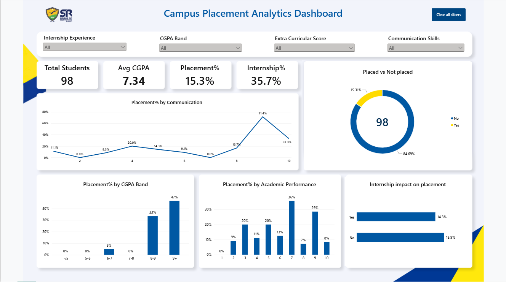

# Campus Placement Analytics Dashboard

An interactive Power BI dashboard that analyses which student attributes (CGPA, communication skills, academic performance, internships) are associated with campus placement outcomes.

---

## 1. Business Problem

Placement cells at colleges track a lot of student data but rarely turn it into decisions. The key questions this project answers:

- What share of students actually get placed?
- Which factors (CGPA, communication skills, academic performance, internship experience) are linked to placement?
- Does doing an internship really improve placement chances?
- Where should the institution focus training and counselling to raise the placement rate?

**Goal:** give the placement team a single, filterable view of student profiles versus placement outcomes so they can target interventions with evidence.

---

## 2. Tools Used

| Tool | Purpose |
|------|---------|
| **Power BI** | Dashboard design, interactive visuals, slicers, KPI cards |
| **DAX** | Calculated measures (Total Students, Avg CGPA, Placement %, Internship %) |
| **Excel / CSV** | Source dataset of student records |

---

## 3. Dataset Overview

Student-level records (98 students) with attributes such as:

- Internship experience (Yes / No)
- CGPA (grouped into bands: <5, 5-6, 6-7, 7-8, 8-9, 9+)
- Extra-curricular score
- Communication skills score (1-10)
- Academic performance score (1-10)
- Placement status (Placed / Not placed)

---

## 4. Analysis Performed

**KPI measures**
- Total Students
- Average CGPA
- Placement % (placed students / total students)
- Internship % (students with internship / total students)

**Visual analysis**
- **Placed vs Not placed** - donut chart of overall placement split.
- **Placement % by Communication** - line chart across communication scores 1-10.
- **Placement % by CGPA Band** - column chart across CGPA bands.
- **Placement % by Academic Performance** - column chart across academic scores 1-10.
- **Internship impact on placement** - bar chart comparing placement % for students with and without an internship.

**Interactivity**
- Slicers: Internship Experience, CGPA Band, Extra Curricular Score, Communication Skills.
- "Clear all slicers" button to reset every filter in one click.
- All visuals and KPIs cross-filter together, so any segment can be drilled into instantly.

---

## 5. Key Insights

1. **Low overall placement rate.** Only **15.3%** of the 98 students are placed; **84.7%** are not placed.
2. **CGPA matters most.** Placement is 0% for students below 6 CGPA and only 5% for 6-7. It rises sharply to **33% for 8-9** and **47% for 9+**.
3. **Strong communication helps, but unevenly.** Placement peaks at **71.4%** at a communication score of about 9, while most lower scores stay between 0% and 20%. It drops to 33.3% at a score of 10, likely because of the small group size.
4. **Academic performance shows a mixed pattern.** Placement is highest at scores **7 (36%)** and **9 (29%)**, so high academic scores help but are not the only deciding factor.
5. **Internships show no clear advantage.** Placement is **14.3%** for students with an internship versus **15.9%** without one. Having an internship alone does not improve outcomes.
6. **Internship participation is moderate.** **35.7%** of students have internship experience. Filtering to this group gives 35 students with an average CGPA of 7.17 and a 14.3% placement rate.

---

## 6. Recommendations

- Run focused **CGPA improvement and mentoring programs** for students below 8 CGPA.
- Add **communication and interview training**, since high communication scores show the strongest placement jump.
- **Improve internship quality** (industry-relevant, outcome-linked) instead of only increasing internship numbers.
- Track placement by segment each semester using this dashboard to measure whether interventions work.

---

## 7. Dashboard Screenshot

---

## 8. Limitations

- Small sample size (98 students), so segment percentages can swing widely; some segments contain very few students.
- The analysis shows association, not causation.

## 9. Author

**Ansh Sharma**

- GitHub: [anshanalytics](https://github.com/anshanalytics)
- LinkedIn: [Ansh Sharma](https://www.linkedin.com/in/ansh-sharma-02445b360)

